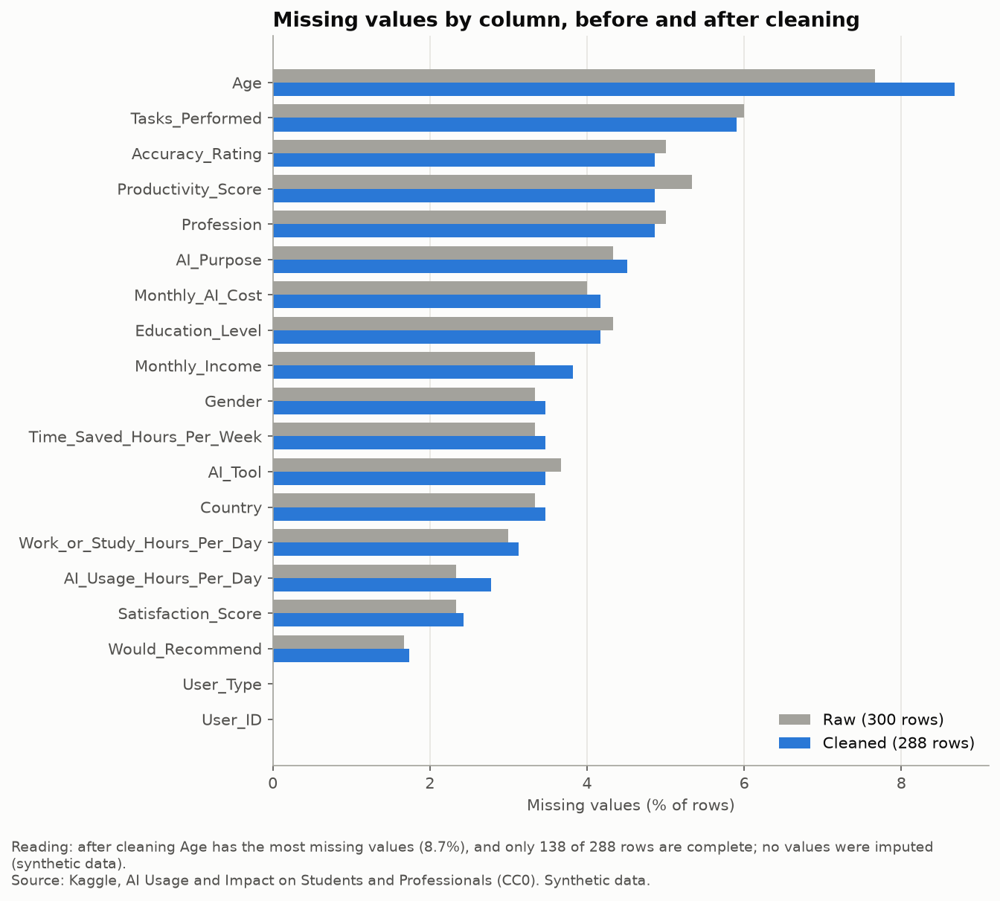
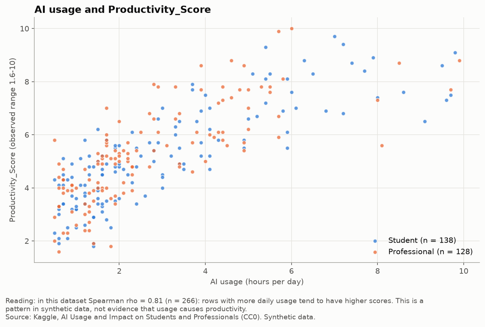
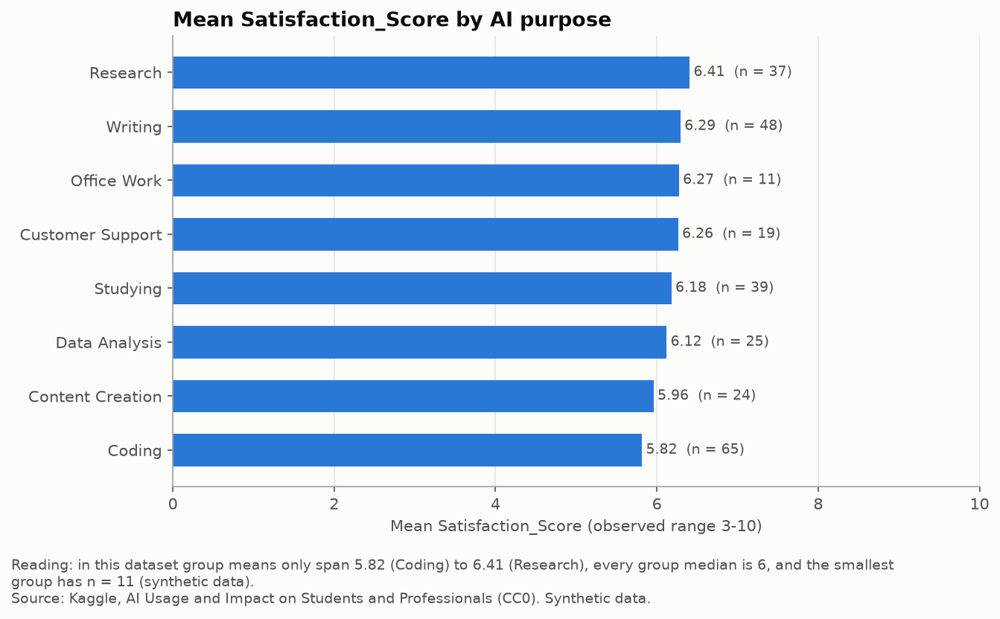
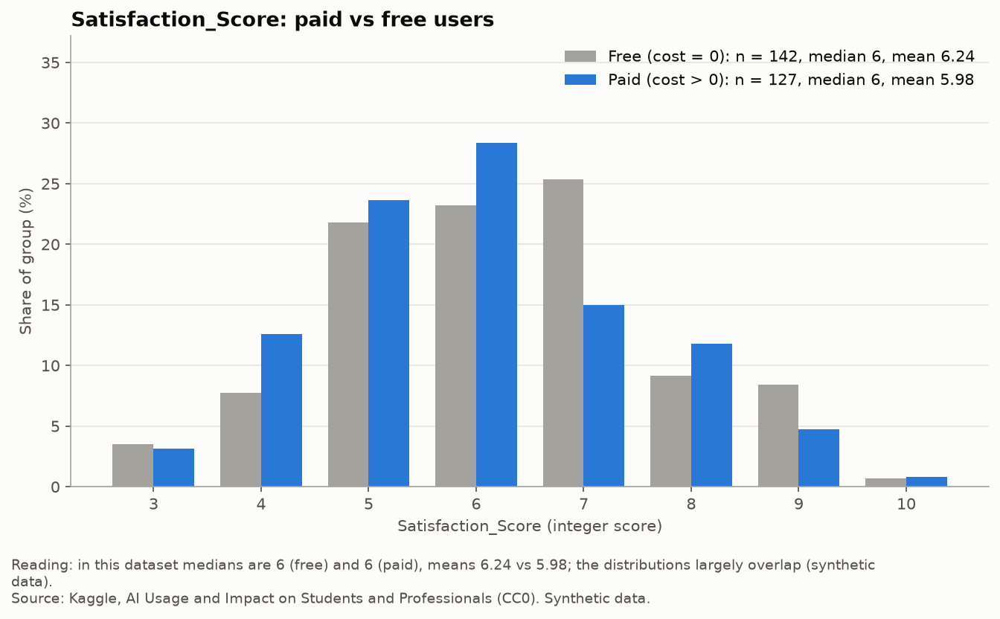
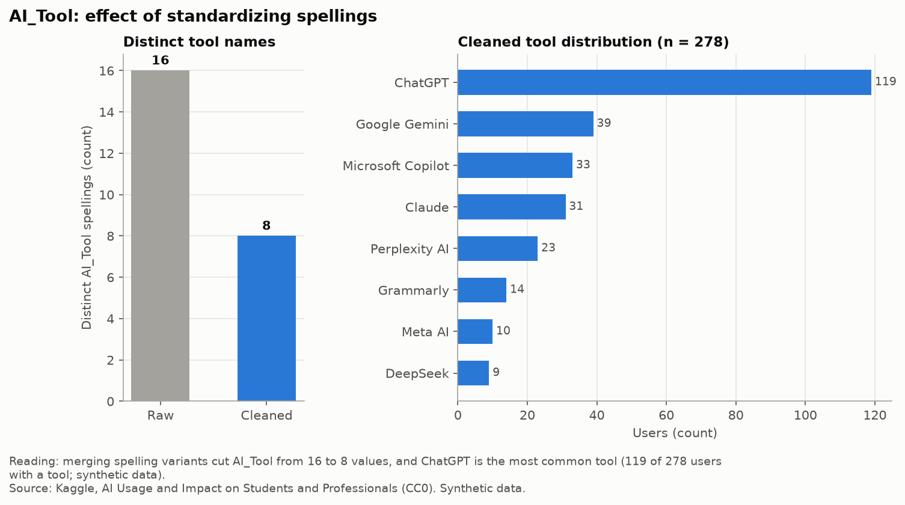
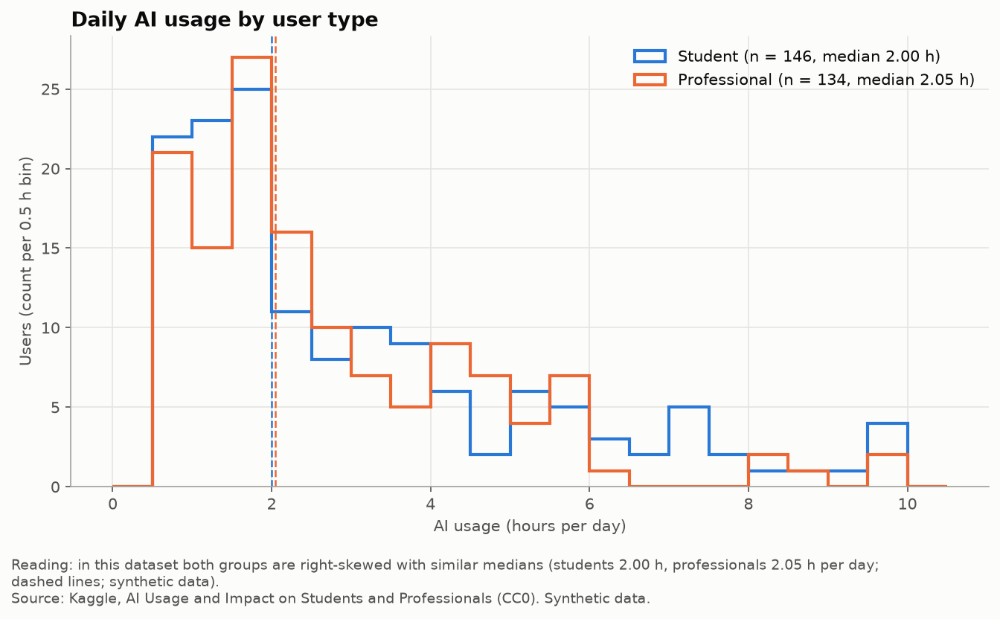

# AI Usage Data: Cleaning and Visualization

   

> **Synthetic data.** According to its author, the dataset was generated for educational purposes, with missing values, duplicates, inconsistent categories and mixed number formats added on purpose. Nothing here describes real students or professionals, and no finding is a claim about the real world.

**Question:** How can a messy, synthetic AI-usage table be made analysis-ready with documented, reproducible steps, and what distributions does the cleaned data show?

## At a glance

| | Raw | Cleaned |
|---|---|---|
| Rows | 300 | 288 (12 exact duplicates removed) |
| Numeric columns stored as text | 6 | 0 (81 cells had units like `"2 hrs"`, `"$0"`) |
| `AI_Tool` spellings | 16 | 8 |
| `Gender` spellings | 11 | 3 |
| `Education_Level` spellings | 16 | 6 |
| `Country` spellings | 20 | 12 |
| Impossible values | 4 (age 97 ×2, 23 h/day AI use, 250,000 income for a 17-year-old) | set to NaN, rows kept |
| Imputed values | | none |
| Automated checks | | 13 / 13 passing |

## Key findings
Every finding is limited by the synthetic data. Each one also has its own limitation.

**1. Dropping missing values per analysis keeps most of the data.**
In this dataset, only 138 of 288 cleaned rows are fully complete, but each single analysis still keeps n = 266-280, because rows are dropped only when they miss a column that analysis uses.
*Limitation:* some category mappings are assumptions (Gemini → Google Gemini, Copilot → Microsoft Copilot, Non-binary → Other), and Undergraduate and Bachelor's are kept separate even though they likely overlap.



**2. Usage time and Productivity_Score rank together strongly.**
In this dataset, daily AI usage and Productivity_Score have Spearman rho = 0.81 (n = 266), with similar values for students (0.82) and professionals (0.80).
*Limitation:* this is a monotonic association, not causation. 23 rows report more AI hours than work/study hours and were kept, so the usage column itself is partly inconsistent.



**3. Satisfaction barely moves across groups.**
In this dataset, mean Satisfaction_Score ranges only from 5.82 (Coding) to 6.41 (Research) across purposes, and every purpose median is 6. Paid and free users average 5.98 and 6.24, with both medians at 6.
*Limitation:* satisfaction is an integer score with 8 observed levels, some groups are small (Office Work n = 11), and no hypothesis test was run, so small mean gaps are not interpreted.

<p>
  
  
</p>

## More figures

<p>
  
  
</p>

Students and professionals have nearly the same median daily usage: 2.00 vs 2.05 hours.

## Product takeaway
Most of the cleaning work here (51 Gender relabels, 16 AI_Tool relabels, 81 numeric cells with units) comes from free-text input. A form with fixed choice lists for categories and numeric-only fields with the unit in the label would remove that work at collection time.

## Method
1. **Validate** the raw CSV: shape, types, missing values, duplicates, unique values (`src/validate_raw.py`).
2. **Clean** with reusable, logged functions (`src/clean.py`):
   - drop exact duplicates, after checking that no `User_ID` is shared by rows with different content
   - strip `$`, `,`, `hrs`, `yrs` and convert to numbers, counting values that fail to convert (0)
   - map category spellings with explicit tables; an unmapped spelling raises an error instead of passing silently
   - flag outliers in `flag_*` columns; only the 4 impossible values are set to NaN
3. **Verify** with a before/after summary, mapping tables and 13 automated checks.
4. **Describe**: descriptive statistics and Spearman correlation only. No ML, no hypothesis tests, no imputation. Each analysis reports its own n.
5. **Visualize** (`src/figures.py`): every figure has a title, axis units, and a one-sentence reading note generated from the computed numbers.

Score columns are read on their own observed scales (Productivity 1.6-10, Accuracy 2-5, Satisfaction 3-10) and never compared directly. `Monthly_Income` has no known currency and is never compared across countries.

## Reproduce
Tested with Python 3.15. Requires a [Kaggle API token](https://www.kaggle.com/docs/api).

```bash
git clone https://github.com/ibrahimbinbuga/ai-usage-data.git && cd ai-usage-data
python3 -m venv .venv && source .venv/bin/activate
pip install -r requirements.txt
kaggle datasets download -d eishatuzzuhra/ai-usage-and-impact-on-students-and-professionals -p data/ --unzip
jupyter nbconvert --to notebook --execute --inplace notebooks/analysis.ipynb
```

Running the notebook regenerates `figures/` and writes `ai_usage_clean.csv`, `cleaning_log.csv` and `category_mappings.csv` to `data/`. The committed notebook keeps its outputs, so it can be read on GitHub without running it.

## Project structure

```
├── data/                    # raw + cleaned CSVs (git-ignored)
├── figures/                 # 6 PNG figures
├── notebooks/analysis.ipynb # full pipeline: validate → clean → verify → analyze → plot
├── src/
│   ├── validate_raw.py      # raw data report
│   ├── clean.py             # cleaning functions + automated checks
│   └── figures.py           # figure functions
├── DEVLOG.md                # step log, decisions and assumptions
└── 05-kalite-kontrol.md     # quality checklist
```

## Data
- Source: [AI Usage and Impact on Students and Professionals](https://www.kaggle.com/datasets/eishatuzzuhra/ai-usage-and-impact-on-students-and-professionals) (Kaggle)
- License: CC0 1.0 (Public Domain)
- The data is not included in this repo.
